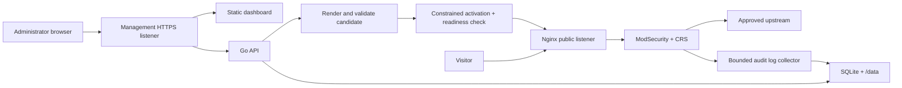

# System Architecture

**Status:** Proposed architecture baseline. No product implementation is currently present in this repository.  
**Canonical detailed design:** [Ariba Shield WAF architecture specification](../ariba-shield-waf-architecture.md).

## 1. Design goals

- Ship a browser-managed application-layer WAF in one Docker image and one running container.
- Keep protected applications outside the WAF container and route to administrator-approved upstreams.
- Separate public protected-site listeners from the management listener.
- Keep desired configuration distinct from validated and running configuration.
- Persist application state in one local volume; do not claim multi-replica SQLite support.
- Make failures observable and preserve the last known-good traffic configuration.

## 2. Proposed components

| Component | Proposed responsibility |
| --- | --- |
| Nginx | Public HTTP/HTTPS listeners, virtual hosts, proxying, TLS termination, and static management assets. |
| ModSecurity v3 + Nginx connector | Request inspection and enforcement. Exact module ABI must match the Nginx build. |
| OWASP CRS | Pinned baseline rules, validated with the exact engine image. |
| Go API | Setup/authentication, typed configuration, SQLite persistence, event queries, jobs, audit, and constrained activation requests. |
| Next.js static export | Browser UI only; Node.js is build-time, not a production server. |
| SQLite | Local persistent users, policy/site definitions, revision metadata, event indexes, and jobs. |
| Supervisor | PID 1 duties, signal forwarding, process supervision, and failure policy; selection pending. |

## 3. Logical data flow

## 4. Network boundaries

Proposed container listeners are 8080 (HTTP), 8443 (HTTPS), 9443 (management HTTPS), and Go API 127.0.0.1:9000 (internal only). Host publishing should bind management to loopback by default. Exact defaults must be validated in the eventual image.

Protected virtual hosts must not proxy to management paths. Trust forwarded client address headers only from explicitly configured reverse proxies. Upstream destinations require administrator-approved CIDRs and checks at resolution/connection time.

## 5. Persistence and failure model

Mount `/data` for SQLite, immutable config revisions, active revision metadata, certificates/keys, logs, backups, and local secret material. SQLite WAL is intended for a single instance on a local filesystem. Do not share the database volume between replicas.

A single container is a single failure domain. The product does not claim high availability. Log collection failure must not block request forwarding, while activation or recovery failure must be visible and can make readiness fail.

## 6. Decisions still pending

Select the process supervisor, base image, dependency pinning method, exact CRS build, non-root volume strategy, architecture support, and management-certificate bootstrap path. Record choices and alternatives before implementation.

## 7. Related designs

- [Project structure](project-structure.md)
- [Database design](database.md)
- [Configuration lifecycle](../development/configuration-lifecycle.md)
- [Deployment plan](../operations/deployment.md)
