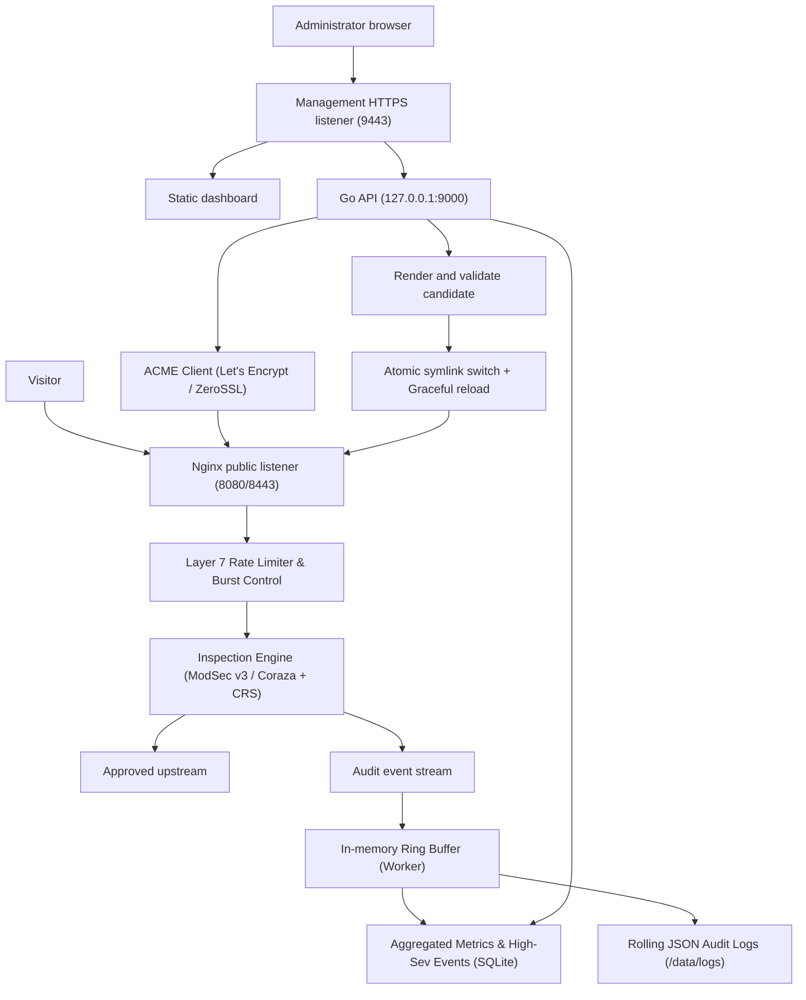

# System Architecture

**Status:** Proposed architecture baseline. No product implementation is currently present in this repository.  
**Canonical detailed design:** [Ariba Shield WAF architecture specification](../ariba-shield-waf-architecture.md).

## 1. Design goals

- Ship a browser-managed application-layer WAF in one Docker image and one running container.
- Keep protected applications outside the WAF container and route to administrator-approved upstreams.
- Separate public protected-site listeners from the management listener.
- Keep desired configuration distinct from validated and running configuration.
- Persist application state in one local volume; do not claim multi-replica SQLite support.
- Make failures observable and preserve the last known-good traffic configuration.

## 2. Proposed components

| Component | Proposed responsibility |
| --- | --- |
| Nginx | Public HTTP/HTTPS listeners, virtual hosts, proxying, TLS termination, ACME HTTP-01 challenge routing, and static management assets. |
| Inspection Engine | ModSecurity v3 (pinned Nginx connector) or OWASP Coraza (Go/Wasm/Cgo). Request inspection, CRS evaluation, and enforcement. |
| OWASP CRS | Pinned baseline rules (CRS v4 recommended), validated with the exact engine image. |
| Go API & Daemon | Setup/authentication, ACME certificate manager, typed configuration compiler, SQLite persistence, tiered event ingestion worker, audit, and constrained activation engine. |
| Next.js static export | Browser UI only; Node.js is build-time, not a production server. |
| SQLite (WAL Mode) | Local persistent users, policy/site definitions, revision metadata, aggregated time-series metrics, and durable jobs. |
| Ring-Buffer Event Collector | In-memory circular buffer with batched flush to SQLite and raw rolling JSON log files; prevents DB locks during flood attacks. |
| Supervisor | PID 1 duties, signal forwarding, process supervision, and failure policy; selection pending (or Go supervisor entrypoint). |

## 3. Logical data flow

## 4. Network boundaries

Proposed container listeners are 8080 (HTTP), 8443 (HTTPS), 9443 (management HTTPS), and Go API 127.0.0.1:9000 (internal only). Host publishing should bind management to loopback by default. Exact defaults must be validated in the eventual image.

Protected virtual hosts must not proxy to management paths. Trust forwarded client address headers only from explicitly configured reverse proxies. Upstream destinations require administrator-approved CIDRs and checks at resolution/connection time.

## 5. Persistence, failure, and enterprise scalability

### Persistence
Mount `/data` for SQLite, immutable config revisions, active revision metadata, certificates/keys, rolling logs, backups, and local secret material. SQLite runs in WAL mode (`journal_mode=WAL`, `synchronous=NORMAL`) with strict busy timeouts for a single instance on a local filesystem. Do not share the database volume between replicas.

### Failure model
A single container is a single failure domain. Log collection failure must never block request forwarding. Activation or recovery failure must be observable, preserve the last known-good configuration, and report readiness failure to health probes.

### Enterprise horizontal scaling (Cluster mode)
For enterprise deployments behind external cloud load balancers (AWS ALB, Cloudflare, HAProxy, Keepalived):
- **Primary / Management Node:** Runs the full stack (Go API, SQLite, UI, Proxy, ACME). Issues signed configuration revision bundles.
- **Stateless Worker Nodes (Edge):** Run proxy + inspection engine without SQLite, receiving cryptographic signed configuration bundles from the primary node via authenticated sync or GitOps.

## 6. Decisions still pending

Select the process supervisor (or Go PID 1 wrapper), base image, dependency pinning method, CRS version (v4 vs v3), non-root volume strategy, architecture support (amd64 / arm64), and ACME DNS-01 provider roadmap. Record choices and alternatives before implementation.

## 7. Related designs

- [Project structure](project-structure.md)
- [Database design](database.md)
- [Configuration lifecycle](../development/configuration-lifecycle.md)
- [Deployment plan](../operations/deployment.md)
