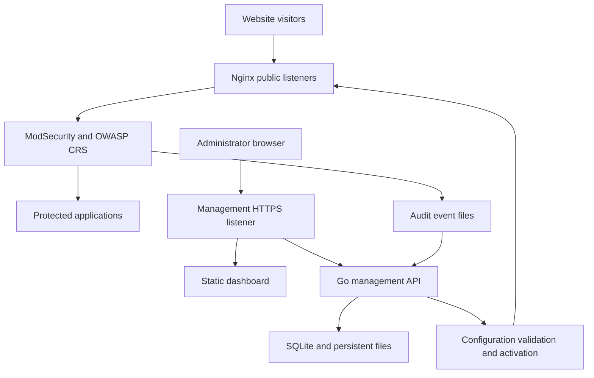

# Ariba Shield WAF — Architecture & Development Specification

**Date:** 9 November 2026  
**Status:** Proposed architecture; implementation and image publication pending.  
**Product:** Open-source, browser-managed Web Application Firewall.  
**Deployment contract:** One Docker image, one running Docker container, one persistent data volume.

## 1. Product goal

Ariba Shield WAF will protect HTTP/HTTPS websites through a reverse proxy and provide a browser dashboard for managing websites, TLS certificates, protection policies, exclusions, events, and configuration history.

User workflow:

`Docker Pull → Docker Run → Browser Open → Initial Setup → Add Website → Test → Enable Protection`

“Single image” means a Docker image containing all runtime components. Multiple supervised processes inside that container are expected. No separate database, cache, frontend, or backend container is required. Protected applications remain outside the WAF container.

This is an application-layer WAF. Operating-system firewall management, VPN, general network routing, antivirus, and volumetric DDoS mitigation are outside the initial scope.

## 2. Architecture decisions

| Component | Decision | Purpose |
| --- | --- | --- |
| Reverse proxy | Nginx | Public HTTP/HTTPS listeners and upstream routing |
| Inspection engine | OWASP Coraza (Go, memory-safe; recommended) or ModSecurity v3 with pinned Nginx connector | Request inspection, anomaly scoring, and enforcement |
| Detection rules | Pinned OWASP Core Rule Set (CRS v4) | Baseline application attack detection with lower false positives |
| Management API | Go | Authentication, configuration, ACME management, audit, event queries, and background jobs |
| Dashboard | Next.js static export | Browser interface served by management listener |
| Database | Embedded SQLite (WAL mode) | Users, policies, site definitions, revisions, and aggregated hourly metrics |
| Process management | s6-overlay or Go supervisor entrypoint | PID 1, process lifecycle, and signal handling |
| Persistence | Docker volume mounted at `/data` | Database, certificates, logs, and active configuration |
| Distribution | Versioned Docker image | Reproducible installation and upgrades |


Next.js is a build-time dependency. The final image serves exported HTML/CSS/JavaScript; Node.js is not required at runtime. Authentication and all dynamic operations belong to Go. Do not depend on Next.js server actions, server-side sessions, or runtime API routes.

### Logical layout



Nginx, ModSecurity, CRS, the static dashboard, Go API, and supervisor are packaged in one container. External protected applications are not part of that container.

## 3. Networking and access

| Host port | Container port | Purpose | Default exposure |
| --- | --- | --- | --- |
| 80 | 8080 | Public website HTTP | Published when needed |
| 443 | 8443 | Public website HTTPS | Published |
| 9443 | 9443 | Dashboard and management API over HTTPS | Host loopback initially |
| None | 127.0.0.1:9000 | Internal Go API listener | Never published |

Keep management routes separate from protected website virtual hosts. A request to a protected site's `/api` or `/admin` must route to that application, never to the WAF management API.

The dashboard uses same-origin `/api/v1` endpoints on the management listener. Remote administration requires deliberate binding to a management interface and network access restrictions. Never trust forwarded client-IP headers from arbitrary visitors; configure trusted proxies explicitly.

## 4. Installation contract

The following is a **target interface for the future published image**, not a command for an existing release. Replace `<registry>` and `<version>` only after the image is built, tested, and published.

```bash
docker volume create ariba-shield-data

docker pull <registry>/ariba-shield-waf:<version>

docker run -d \
  --name ariba-shield-waf \
  --restart unless-stopped \
  -p 80:8080 \
  -p 443:8443 \
  -p 127.0.0.1:9443:9443 \
  -v ariba-shield-data:/data \
  <registry>/ariba-shield-waf:<version>
```

Open `https://localhost:9443` on the Docker host or use an authenticated SSH tunnel. Initial management TLS may use a generated self-signed certificate; the setup process must allow replacing it with a trusted certificate.

Bootstrap design: a CLI inside the container generates a short-lived, single-use enrollment token. An administrator opens the setup page and exchanges that token to create the first account. Store only a token hash. Disable enrollment after setup and never ship a fixed default password.

No privileged mode, Docker socket mount, or host networking is required.

## 5. Dashboard scope

| Page | Initial capabilities |
| --- | --- |
| Overview | Requests, blocks, detection events, enabled sites, and component health |
| Websites | Domain names, HTTP/HTTPS upstreams, TLS settings, and policy assignment |
| Protection policies | Off, DetectionOnly, and Blocking; CRS settings and limits |
| Events | Date/site/action/rule filters, transaction detail, and pagination |
| Exclusions | Site-scoped rule/parameter/path exceptions with a reason |
| Certificates | Upload, inspect, expiry tracking, and site assignment |
| Configuration | Draft, validation results, apply, applied revision, and rollback |
| Administration | Users, roles, sessions, audit trail, retention, and backups |

Use Admin, Operator, and Viewer roles. Enforce permissions in the API. Mark simulated frontend data as demo data during development; production metrics must come from actual events and counters.

“Detection event” and “blocked request” are separate measures. Multiple rule matches may belong to a single request. Specify the metric definition and time window on each dashboard card. A collector failure must show stale or unavailable data rather than a misleading zero.

## 6. Website and policy model

A website contains: ID, display name, validated domain list, listen settings, upstream endpoints, upstream TLS policy, certificate reference, protection policy, enabled state, and applied revision.

A policy contains: engine mode, CRS paranoia level, anomaly thresholds, request body and upload limits, parser settings, rate-limit options, trusted proxies, and scoped exclusions.

Start new sites in DetectionOnly, review representative traffic, and enable Blocking after tuning. Clearly show that DetectionOnly records detections without blocking them.

Use built-in parsers for configured content types and verify JSON, form, and multipart handling in integration tests. Define explicit behavior for oversized or uninspectable request bodies; do not silently advertise complete inspection when limits are exceeded.

Validate hostnames, ports, paths, CIDRs, and upstream schemes using typed input. Restrict upstream destinations to administrator-approved networks and explicitly deny metadata endpoints, management listeners, and unintended loopback targets. Private upstreams are legitimate and must remain configurable.

Prefer structured controls over arbitrary Nginx or shell snippets. Advanced raw-rule editing may be added later with stronger validation and revision tracking.

## 7. Safe configuration lifecycle

1. Save a validated desired configuration as a new draft revision.
2. Serialize apply jobs so only one activation can run at a time.
3. Render a complete immutable candidate revision using controlled templates.
4. Run the Nginx configuration test against that candidate, including connector and rule loading.
5. Reject invalid candidates and return useful validation errors.
6. Persist an activation intent, atomically update the active configuration pointer, then request a graceful reload using a fixed executable and arguments.
7. Verify reload completion and perform a bounded local readiness check using the intended site and revision.
8. Mark the revision applied only after verification. On failure, restore and reload the last known-good revision.
9. Record actor, timestamps, revision checksums, and activation outcome.

Keep desired, validated, and applied state distinct. A successful database write does not prove a running configuration changed. On restart, reconcile any interrupted activation from the journal and active revision metadata.

Do not interpolate browser input into shell commands. Configuration activation must work through constrained operations rather than a general command-execution endpoint.

## 8. Persistence and event collection

| Path | Contents |
| --- | --- |
| `/data/db/ariba.db` | SQLite database and schema migrations |
| `/data/config/revisions/` | Immutable generated configuration revisions |
| `/data/config/active` | Current active revision reference |
| `/data/certs/` | Certificates and private keys |
| `/data/logs/` | Rotated access and ModSecurity audit event files |
| `/data/backups/` | User-requested backup archives, subject to retention |
| `/data/secrets/` | Local secret material with restricted permissions |

Use SQLite WAL mode on a local filesystem, bounded transactions, a busy timeout, and serialized writes where appropriate. The embedded design is for one instance; multiple replicas must not share this SQLite volume.

Collect ModSecurity audit records through a bounded background worker. Persist file identity and offsets, handle rotation and partial records, and deduplicate indexed records using a stable event identity. Keep access counters separate from security matches.

Limit event size, index growth, queue memory, and disk retention. Redact sensitive headers and parameters before storing or exporting them. Request and response bodies should not be retained by default. Log ingestion failure must not stall public traffic; surface lag, dropped records, and disk-pressure status.

Use SQLite's online backup facilities or a stopped, consistent snapshot. A live copy of only the `.db` file is insufficient when WAL is active. Backups must capture matching configuration, database, and required secrets, with clear protection for private keys. Test restore into a clean instance.

## 9. API outline

| Group | Example operations |
| --- | --- |
| Setup | Obtain setup status; enroll using a one-time token |
| Authentication | Login, logout, revoke sessions, and change password |
| Websites | List, create, update, disable, and delete definitions |
| Policies | Manage policies, modes, and structured exclusions |
| Events | Paginated event queries and transaction details |
| Certificates | Upload and validate matching certificate/key pairs |
| Configuration | Create draft, validate, apply, query job, and rollback |
| System | Health, version, retention, backup, and restore jobs |

Use versioned `/api/v1` routes, stable error codes, request size limits, and bounded query ranges. Apply/restore operations return job IDs and expose status. Require current revision checks on updates to prevent lost edits.

Passwords use an established password-hashing implementation such as Argon2id. Use Secure, HttpOnly, SameSite session cookies, session expiration, and CSRF protection for mutations. Limit login attempts and audit management changes. Never return private keys, password hashes, enrollment tokens, or session secrets through ordinary list/detail endpoints.

## 10. Build and container operations

Use a multi-stage Docker build: compile the dashboard export and Go binary, then copy only runtime artifacts into the final image with Nginx, compatible ModSecurity connector, libModSecurity, CRS, and the supervisor.

Pin base-image digests and dependency versions. Test Nginx/module ABI compatibility in the exact final image. Keep compilers, source trees, and package-manager caches outside that image. Publish dependency notices and a software bill of materials.

Use high internal ports and a dedicated runtime identity. Provide a documented volume-permissions initialization strategy that works with the chosen non-root runtime. The Go API should not need root. The supervisor must forward signals, reap child processes, and stop the container on unrecoverable critical-process failure.

Expose separate liveness and readiness signals. A Docker healthcheck reports health but does not itself guarantee container restart; critical failures must trigger the chosen supervisor policy. Reload validation failures keep the last known-good configuration serving.

## 11. Open-source distribution

Publish source, build instructions, Dockerfile, tests, configuration templates, documentation, changelog, and vulnerability-reporting instructions. Proposed license for original Ariba code: Apache-2.0, subject to dependency license review before release. Preserve third-party licenses and notices; packaging upstream components does not change their licenses.

All MVP functionality should run locally without a paid service or mandatory external account. Use explicit version tags and immutable digests for deployments. Automated dependency upgrades must pass compatibility and enforcement tests before release.

## 12. Development milestones

1. **Working WAF prototype:** Build one container; route one demo application; verify a benign request, a controlled CRS detection, Blocking behavior, TLS, and graceful reload.
2. **Configuration API:** Add SQLite models, schema migrations, typed validation, revision rendering, activation journal, and rollback.
3. **Browser management:** Implement initial setup, login, website/policy forms, and apply status using real API responses.
4. **Event visibility:** Add collection, filtering, accurate counters, retention, redaction, and health indicators.
5. **Operational readiness:** Implement certificate management, role enforcement, backup/restore, container upgrades, and failure recovery tests.
6. **Open-source release:** Publish tested source, signed/versioned image where supported, notices, SBOM, and setup documentation.

Frontend design can proceed early, but the first technical milestone must demonstrate the complete traffic and enforcement path.

## 13. Release acceptance criteria

- A clean Docker host can install the product using one image and one running container.
- No PostgreSQL, Redis, Node.js runtime, or separate frontend/backend service is required.
- Sites, certificates, and policies persist across container replacement using the same volume.
- DetectionOnly allows and records the controlled test; Blocking rejects it; normal requests pass under the tested policy.
- Invalid configuration cannot replace the last known-good running revision.
- Management endpoints remain inaccessible through protected website listeners.
- Role checks, session handling, and CSRF protection are verified through API tests.
- Certificate/key mismatches, upstream TLS failures, and inspection limits produce visible errors.
- Restart during apply, log rotation, disk pressure, and collector backlog have tested outcomes.
- Backup restores successfully into a fresh instance with documented version compatibility.
- The exact release image passes routing, enforcement, module-loading, and lifecycle tests.

A single container is a single failure domain. High availability and multi-instance state coordination are future architecture work; this release makes no untested throughput or availability guarantees.

## 14. Local development workflow

During development, run the dashboard, Go API, and WAF engine separately for faster iteration. The release artifact still follows the deployment contract: one image and one container. Local development topology is not the production topology.

| Component | Local development process | Example address or data path |
| --- | --- | --- |
| Next.js dashboard | `npm run dev` | `http://localhost:3000` |
| Go management API | `go run ./cmd/ariba` | `http://localhost:9000` |
| Nginx + ModSecurity + CRS | Dedicated development container | `http://localhost:8080` |
| SQLite | Opened by the Go API | `./dev-data/ariba.db` |
| Demo upstream application | Small test application | `http://localhost:8081` |

Suggested development sequence:

1. Keep frontend, backend, deployment assets, documentation, and local test data in the repository. Exclude `dev-data/` and other runtime state from version control.
2. Bring up the WAF development container and route a demo application through it. Ensure the upstream is reachable from the container; `localhost` inside a container refers to that container, not the host.
3. Implement the API incrementally: health, SQLite migrations, website and policy management, then validation, apply jobs, and rollback.
4. Configure the Next.js development server to proxy `/api/v1` requests to the Go API. This keeps browser requests same-origin during development. Add setup/login, website and policy forms, and event views against real API responses.
5. Build and test the integrated image, then verify the end-to-end flow: add a website, apply configuration, send traffic, and inspect events.

The host-run Go API cannot directly reload Nginx in a separate container. Until the integrated image supports the full activation path, validate and reload development Nginx configuration manually. Test automated apply and rollback in the integrated container, where the API and Nginx share the intended runtime environment.

The first development milestone is a demo site served through the WAF, with a controlled detection visible in DetectionOnly mode and a controlled request blocked in Blocking mode. Build the traffic/enforcement path before relying on dashboard functionality.

## 15. Dashboard navigation roadmap

The following is a product-navigation proposal, not a commitment that every item ships in the MVP. MVP capabilities are defined in Section 5; items not listed there require separate prioritization and design.

| Area | Proposed pages |
| --- | --- |
| Overview | Dashboard |
| Protection | Websites, origin servers, security policies, CRS rules, custom rules, exclusions, rate limiting, IP allow/block lists |
| Monitoring | Attack monitoring, blocked requests, traffic analytics, access logs, WAF audit logs, admin audit logs |
| Management | Certificates, TLS configuration, security and traffic reports |
| System | Health, backup and restore, notifications, general settings, administrator and authentication settings, about |

IP reputation, scheduled reports, and other advanced capabilities are future candidates and are not part of the initial release acceptance criteria.

## 16. Reference documentation

- ModSecurity Nginx integration: https://modsecurity.org/docs/2-installation/2-2-libmodsecurity-v3-nginx/
- OWASP CRS installation: https://coreruleset.org/docs/1-getting-started/1-2-extended_install/
- Next.js static export: https://nextjs.org/docs/app/building-your-application/deploying/static-exports

These references support the component choices. Product-specific behavior described above is a development requirement and must be verified in the implementation.
